# Question-to-image review

Each image is a fictional invitation. Recognition intent is an editorial brief, not reader-tested evidence.

## S01 · Before we said hello

### Question 1

What was on your mind before our first date?

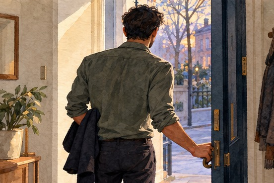

Recognition cue: Anticipation before leaving.

### Question 2

What do you remember doing to get ready for our first date?

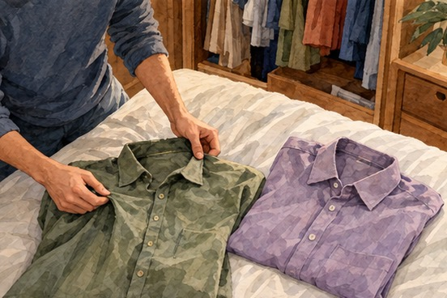

Recognition cue: Choosing clothes.

### Question 3

When you first saw me that day, what caught your eye?

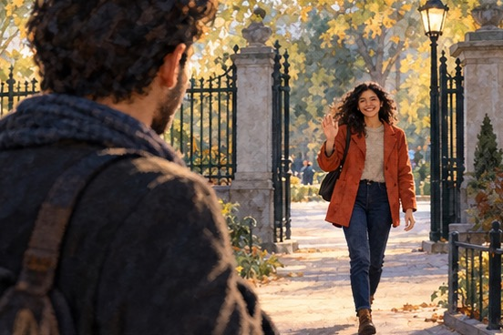

Recognition cue: The first glimpse.

### Question 4

What small moment from our first date has stayed with you?

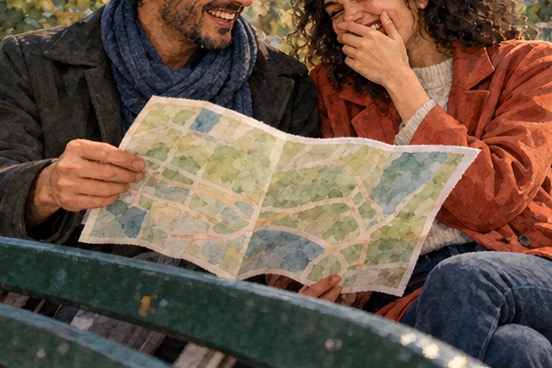

Recognition cue: A small shared moment.

### Question 5

When our first date ended, what did you hope would happen next?

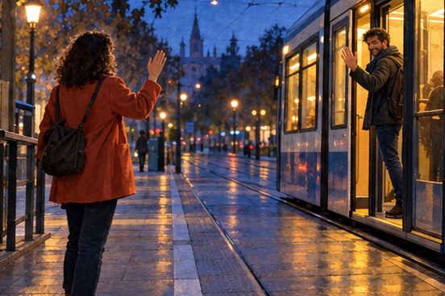

Recognition cue: Hope after goodbye.

### Closing

If you like, keep one detail from the start of our story.

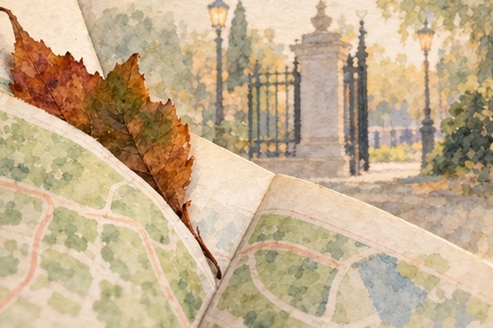

Recognition cue: Keeping one early detail.

## S02 · That is so us

### Question 1

What is one moment with me that still makes you laugh?

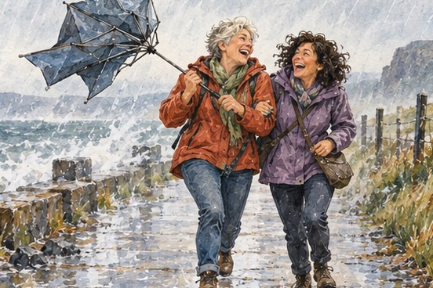

Recognition cue: Shared laughter.

### Question 2

What was going on just before that funny moment?

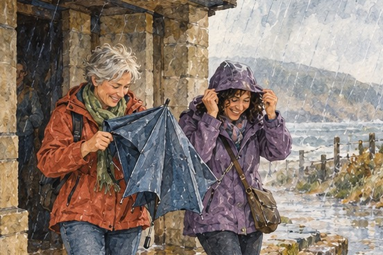

Recognition cue: Before the funny moment.

### Question 3

What part of that moment makes you laugh the most?

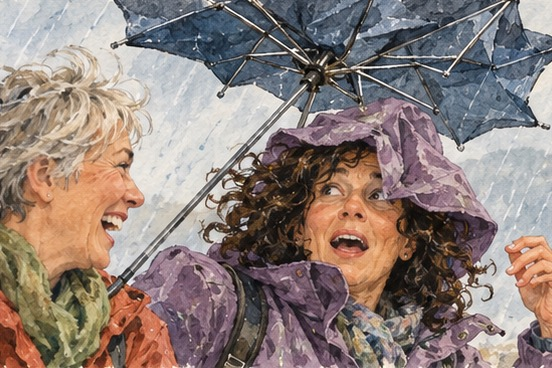

Recognition cue: The funniest detail.

### Question 4

What makes that joke feel like one of ours?

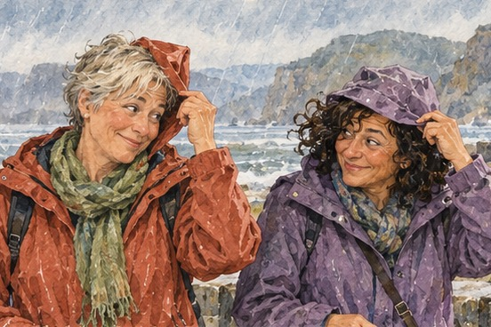

Recognition cue: Our private joke.

### Question 5

How would you tell that funny story to someone who was not there?

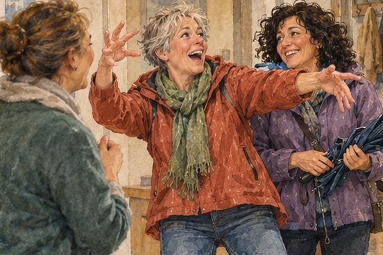

Recognition cue: Retelling the story.

### Closing

If you like, give our funny story a name to keep.

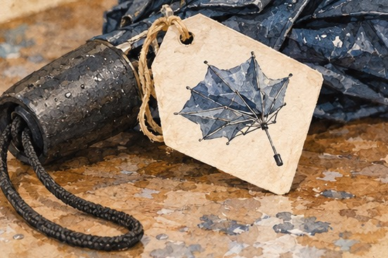

Recognition cue: A name for the joke.

## S03 · The trip that went sideways

### Question 1

Think of a trip where our plan changed. What had we planned to do?

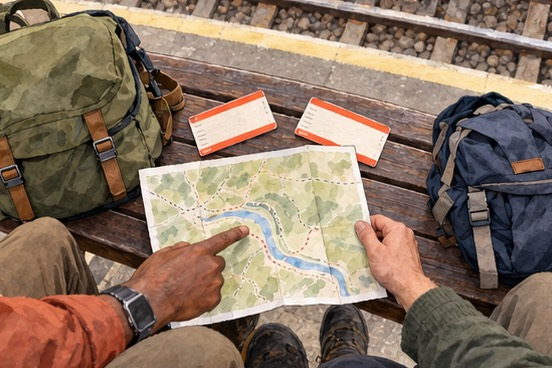

Recognition cue: The original travel plan.

### Question 2

What happened on that trip that we did not expect?

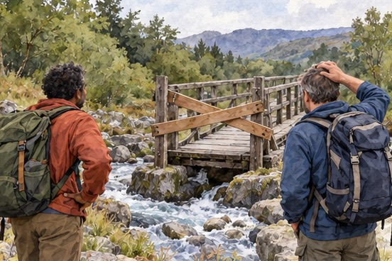

Recognition cue: An unexpected obstacle.

### Question 3

What did you do when our plan changed?

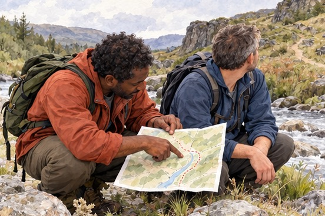

Recognition cue: Responding to a changed plan.

### Question 4

How do you feel about that change of plan now?

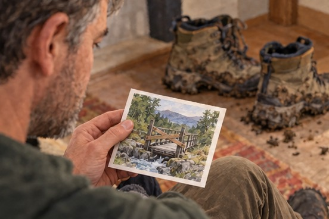

Recognition cue: Looking back on the detour.

### Question 5

What part of that trip would you tell someone about first?

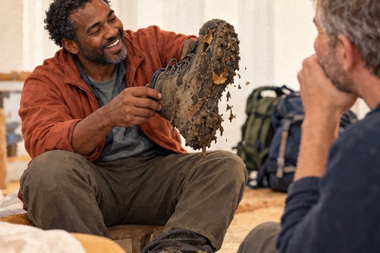

Recognition cue: The part worth telling.

### Closing

If you like, keep one line from our day that went off plan.

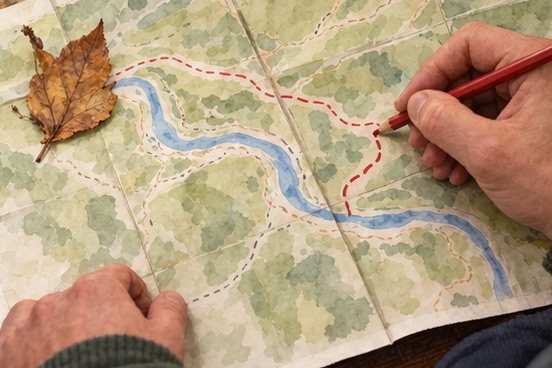

Recognition cue: Keeping a line from the trip.

## S04 · Our little habit

### Question 1

What small thing do we do that feels like our thing?

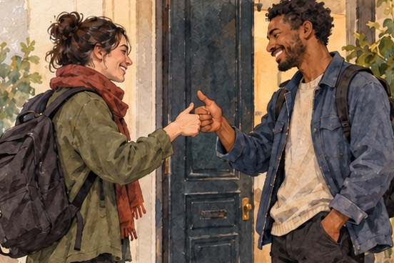

Recognition cue: Our shared little habit.

### Question 2

What do you remember about how our little habit started?

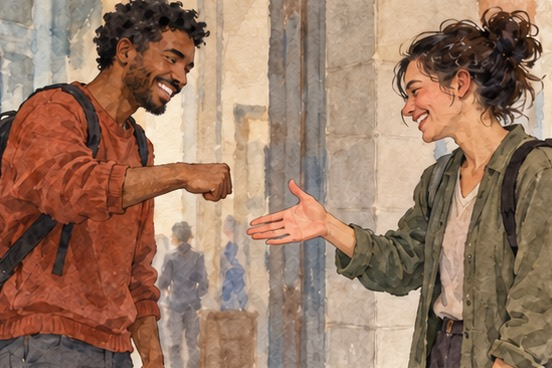

Recognition cue: How the habit began.

### Question 3

What part of our little habit do you look forward to?

Recognition cue: Looking forward to a ritual.

### Question 4

What does that little habit mean to you?

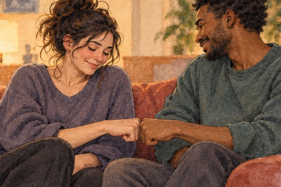

Recognition cue: What a small habit means.

### Question 5

How would you like that habit to fit our life now?

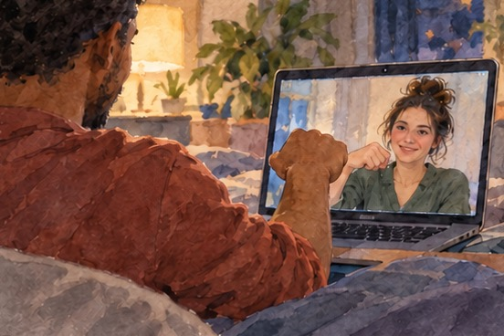

Recognition cue: Adapting a habit to life now.

### Closing

If you like, keep a small picture in words of our little habit.

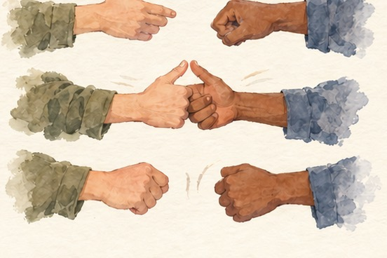

Recognition cue: A small picture of our habit.

## S05 · What came with you

### Question 1

What small habit or rule do you remember from where you grew up?

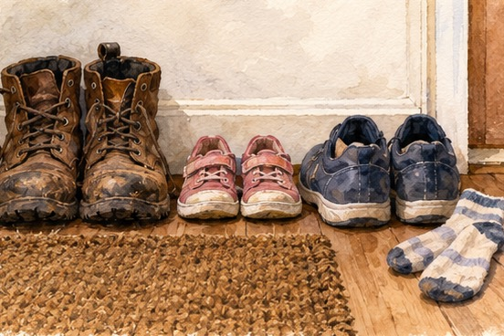

Recognition cue: A childhood house rule.

### Question 2

What did that habit or rule look like on a normal day?

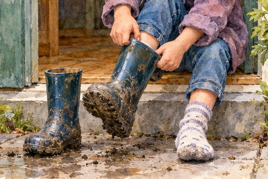

Recognition cue: The rule on an ordinary day.

### Question 3

How did that habit or rule feel to you back then?

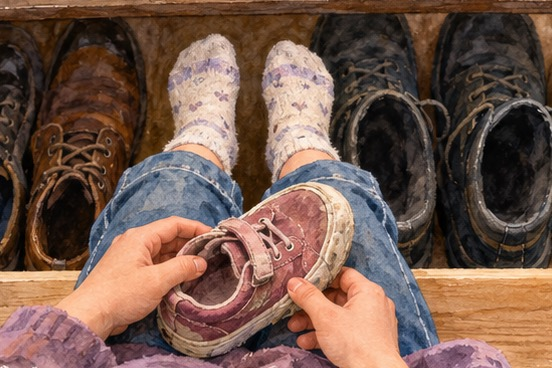

Recognition cue: How it felt as a child.

### Question 4

Where does that old habit or rule show up in your life now?

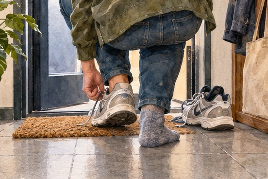

Recognition cue: The old habit in adult life.

### Question 5

What would you like to keep or change about that habit or rule?

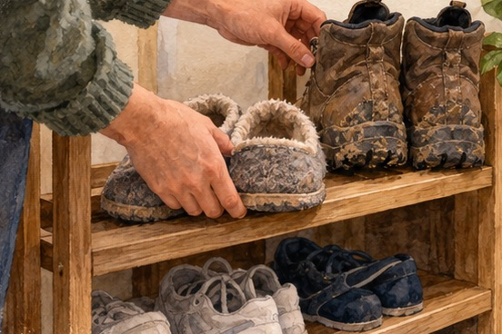

Recognition cue: Keep it or change it.

### Closing

If you like, keep one thing you want me to know about that part of your life.

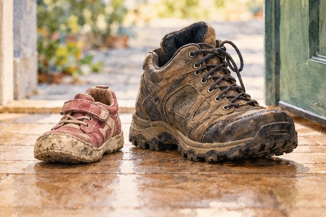

Recognition cue: Something from where I grew up.

## S06 · When the day is done

### Question 1

Think of your last busy day. What were you doing when it finally slowed down?

Recognition cue: The busy day finally slows.

### Question 2

After a busy day like that, what do you want first?

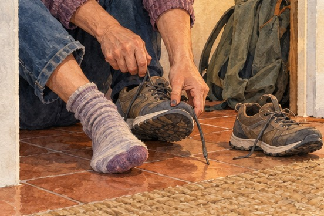

Recognition cue: The first thing I need.

### Question 3

When your day ends, how do you like me to be there for you?

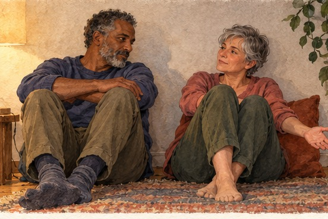

Recognition cue: How to be there for me.

### Question 4

How could you let me know what you need after a busy day?

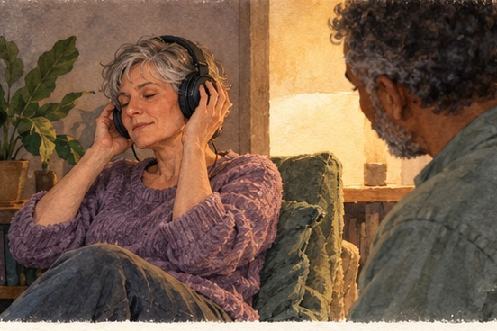

Recognition cue: A clear signal for what I need.

### Question 5

What small thing from me could make your next busy evening easier?

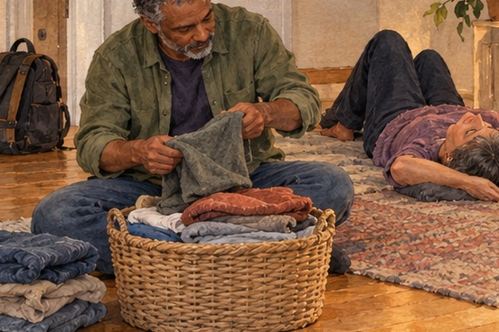

Recognition cue: A little practical help.

### Closing

If you like, keep a few words that help us check in after a full day.

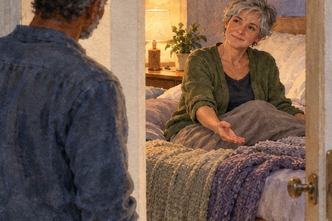

Recognition cue: A way to check in after a full day.

## S07 · I notice that

### Question 1

What is one small thing I do that you like?

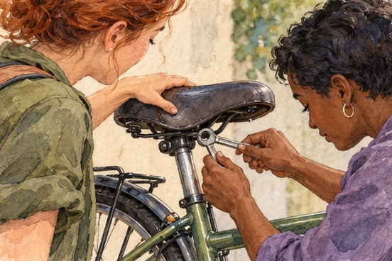

Recognition cue: A small thing I like you doing.

### Question 2

When did you last notice me doing that small thing?

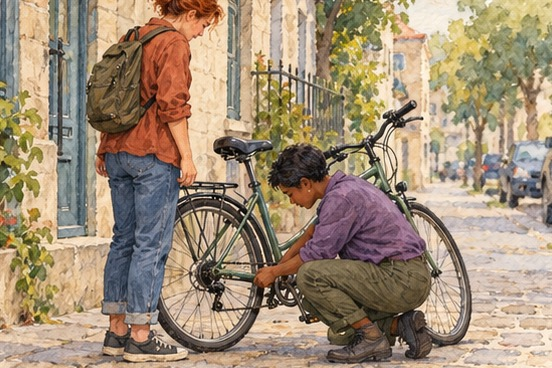

Recognition cue: One real moment I noticed it.

### Question 3

What did that small thing mean to you at the time?

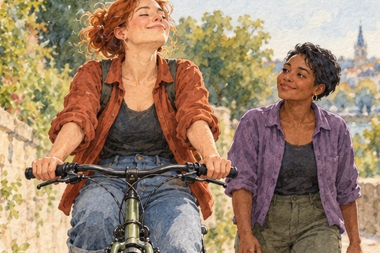

Recognition cue: What the gesture meant.

### Question 4

What would you like me to know about that small thing I do?

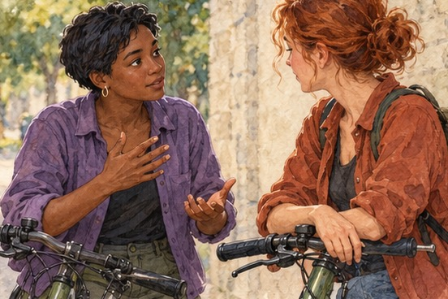

Recognition cue: What I want you to know.

### Question 5

How do you like me to show that I notice the things you do?

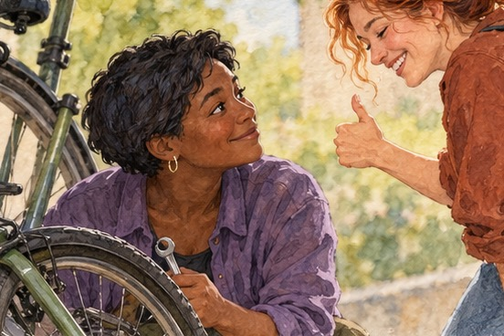

Recognition cue: How I like to be noticed.

### Closing

If you like, keep a few words about a small thing that mattered.

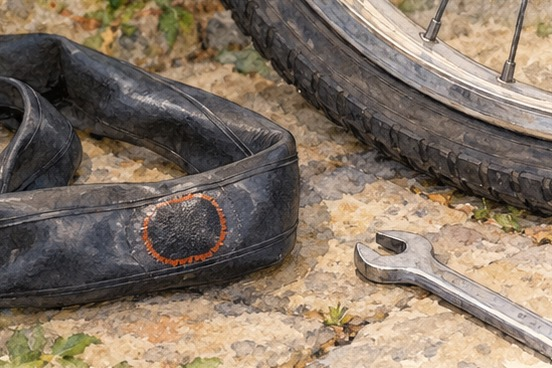

Recognition cue: Keeping the small thing that mattered.

## S08 · Close, in your own way

### Question 1

What kind of touch from me do you enjoy, if any?

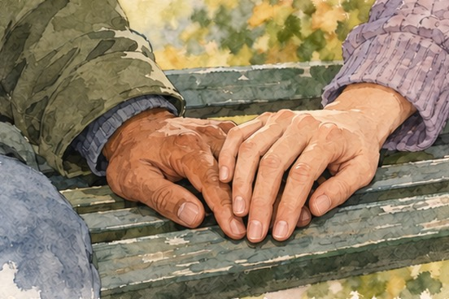

Recognition cue: Chosen light touch.

### Question 2

At what times does touch from me feel welcome?

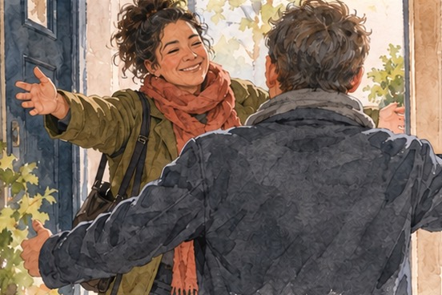

Recognition cue: A welcome moment for affection.

### Question 3

At what times would you rather have some space from touch?

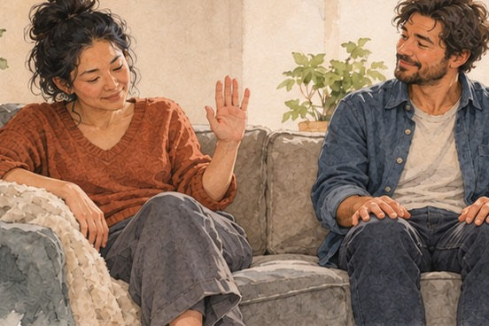

Recognition cue: A respected request for space.

### Question 4

How would you like me to ask before I touch you?

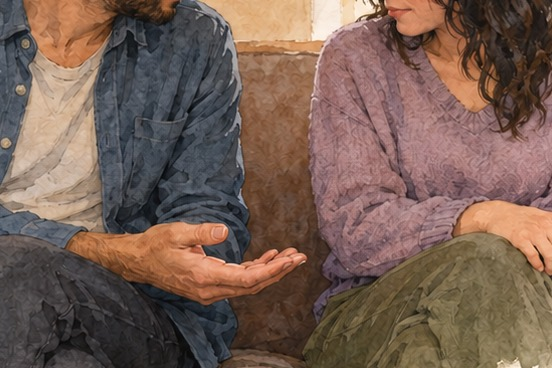

Recognition cue: Asking before touch.

### Question 5

What would you like me to remember about touch with you?

Recognition cue: What to remember about touch.

### Closing

If you like, keep one thing you want me to know about touch. We can leave it here too.

Recognition cue: Together with space.

## S09 · The small thing we get stuck on

### Question 1

What small thing do we keep getting stuck on?

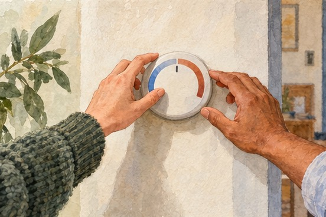

Recognition cue: A recurring small clash.

### Question 2

Think of the last time that came up. What mattered to you then?

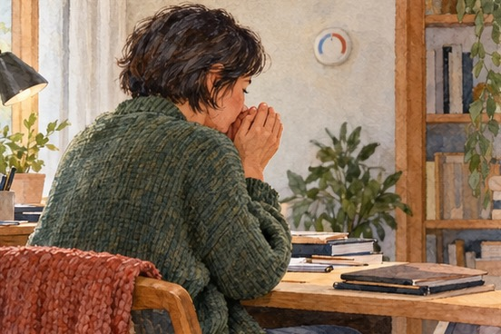

Recognition cue: What mattered to me then.

### Question 3

What do you wish I had understood in that moment?

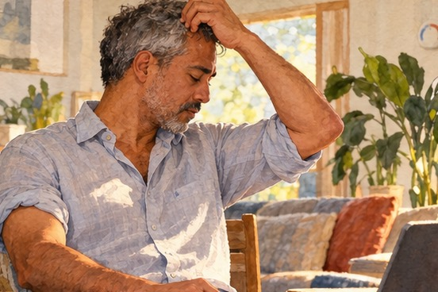

Recognition cue: The part I wish you understood.

### Question 4

What could we say if that talk starts to feel tense?

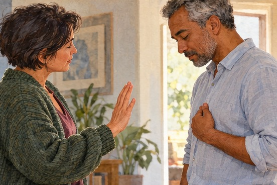

Recognition cue: A way to pause a tense talk.

### Question 5

What is one small thing we could try when that issue comes up again?

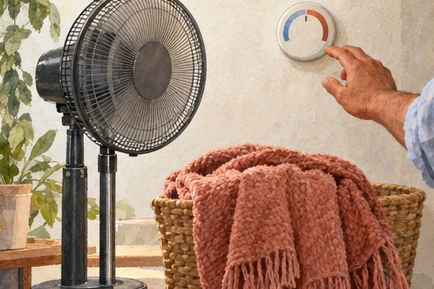

Recognition cue: One small possible change.

### Closing

If you like, keep one thing you want me to understand. We can leave the issue open.

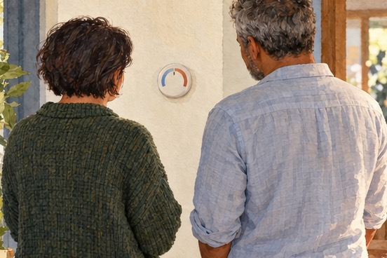

Recognition cue: We can leave the issue open.

## S10 · One small money choice

### Question 1

What small money choice have you made lately?

Recognition cue: A recent money choice.

### Question 2

Why did that money choice matter to you?

Recognition cue: Why the choice mattered.

### Question 3

What rule about money did you grow up with?

Recognition cue: The money rule I grew up with.

### Question 4

Which part of that old money rule still fits your life?

Recognition cue: What still fits my life.

### Question 5

How would you like us to talk about a money choice like this?

Recognition cue: How we talk about money.

### Closing

If you like, keep one thing you want me to understand about money. No budget needed tonight.

Recognition cue: What to understand about money.

## S11 · A Saturday just for us

### Question 1

If we had a whole Saturday free, how would you like to start it with me?

Recognition cue: A slow free morning.

### Question 2

Where would you like our free Saturday to take us next?

Recognition cue: Where the day takes us.

### Question 3

What silly thing could we add to our Saturday just for fun?

Recognition cue: Something silly just for fun.

### Question 4

How would you like our free Saturday to end?

Recognition cue: How the day ends.

### Question 5

Which small part of our made-up Saturday would you like to try?

Recognition cue: One small piece to try for real.

### Closing

If you like, keep one scene from our made-up Saturday.

Recognition cue: A scene from our made-up day.

## S12 · Our first try

### Question 1

What new thing would you like to try with me?

Recognition cue: Curiosity about a new try.

### Question 2

Picture us trying that new thing. What part would you look forward to?

Recognition cue: Looking forward to the first minutes.

### Question 3

If our first try went badly, what could make it fun anyway?

Recognition cue: Fun when a first try goes wrong.

### Question 4

When you try something new, what kind of help do you like from me?

Recognition cue: Help offered on my terms.

### Question 5

What would a small first try of our idea look like?

Recognition cue: A small first attempt.

### Closing

If you like, keep our idea for a first try. It can stay an idea.

Recognition cue: An idea allowed to wait.

## S13 · A dream with no due date

### Question 1

What is something you would love to do one day?

Recognition cue: A wish for one day.

### Question 2

Picture a day when that dream is real. What are you doing?

Recognition cue: A day when the dream is real.

### Question 3

What do you hope that dream would add to your life?

Recognition cue: What the dream adds to life.

### Question 4

What would you like from me while you think about that dream?

Recognition cue: The support I want from you.

### Question 5

What small step, if any, would you like to take toward that dream?

Recognition cue: A small first step, if any.

### Closing

If you like, keep a few words about the dream. We can leave the date blank.

Recognition cue: The dream can wait.

## S14 · Time to be me

### Question 1

What do you enjoy doing on your own these days?

Recognition cue: Something I enjoy on my own.

### Question 2

What do you like about having that time for yourself?

Recognition cue: How time for myself feels.

### Question 3

What tends to get in the way of time for yourself?

Recognition cue: What gets in the way.

### Question 4

What would you like me to know about your need for time on your own?

Recognition cue: What I want you to understand.

### Question 5

What bit of time would you like for yourself in the days ahead?

Recognition cue: A little time in the days ahead.

### Closing

If you like, keep a few words about a part of you that needs some room.

Recognition cue: A part of me with room to breathe.

## S15 · A change we can see coming

### Question 1

What change in your life has been on your mind lately?

Recognition cue: A change on my mind.

### Question 2

What might a normal day look like after that change?

Recognition cue: An ordinary day after change.

### Question 3

As life changes, what would you like us to keep making time for?

Recognition cue: What we keep making time for.

### Question 4

What feels hard to know about that change right now?

Recognition cue: What I cannot know yet.

### Question 5

What kind of support from me would feel good as things change?

Recognition cue: Support that would feel good.

### Closing

If you like, keep one way we can be there for each other. The rest can stay open.

Recognition cue: One way to be there as things change.

